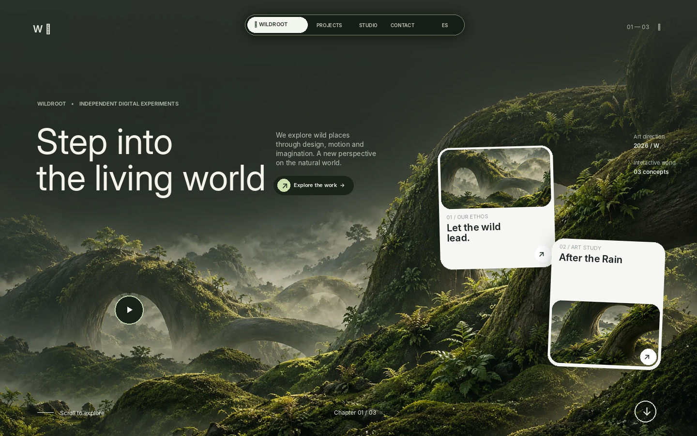

# WILDROOT — Portafolio 2 (concepto)

Una experiencia web inmersiva inspirada en la naturaleza. El objetivo es un proyecto con: atmósfera verde oscura, paisaje orgánico, elementos flotantes, tipografía editorial y microinteracciones.

> **Transparencia del portafolio:** WILDROOT es un estudio ficticio y sus tres proyectos son conceptos creativos originales, no trabajos encargados por clientes. No se presentan métricas, premios ni relaciones comerciales reales. La imagen de fondo es una ilustración original generada para esta demostración.



_La vista previa es un mockup del diseño esperado, no una captura de una compilación ejecutada._

## Tecnologías

- **Next.js 15** con App Router
- **React 19**
- **TypeScript**
- **CSS moderno**, sin bibliotecas de componentes o animación
- `IntersectionObserver` para revelado al hacer scroll
- Transiciones CSS con parallax y soporte para `prefers-reduced-motion`

## Funcionalidades

- Portada cinematográfica con ilustración local de naturaleza y entrada animada.
- Navegación flotante, sección de trabajos y scroll suave.
- Dos tarjetas de proyecto flotantes con animaciones y modal funcional.
- Modo de experiencia inmersiva (no se presenta como reproducción de un video real).
- Tres fichas de exploración que abren detalles sin navegar fuera del sitio.
- Textos en **inglés y español**, intercambiables desde la navegación.
- Diseño adaptable a escritorio, tablet y móvil.
- Navegación por teclado, texto alternativo y respeto a movimiento reducido.

## Inicio rápido

**Requisitos:** Node.js 20 o superior y npm.

```bash
npm install
npm run dev
```

Abre [http://localhost:3000](http://localhost:3000).

Para probar la compilación de producción:

```bash
npm run build
npm run start
```

## Estructura

```text
app/
  globals.css       # Layout, animaciones, responsive y componentes visuales
  icon.svg          # Favicon
  layout.tsx        # Metadatos, configuración y estilos globales
  page.tsx          # Home, traducciones, tarjetas y modales interactivos
public/images/
  hero-landscape.webp  # Arte principal optimizado
  project-*.webp       # Variaciones utilizadas en los conceptos
```

## Qué personalizar antes de publicarlo como tuyo

1. Cambia `WILDROOT` y sus textos por la identidad que quieras presentar.
2. Cambia los proyectos ficticios por tus propios proyectos si deseas mostrarlos como casos reales.
3. Sustituye **`hello@wildroot.example`** en `app/page.tsx` por tu email; es una dirección de ejemplo, no una bandeja real.
4. Ajusta el `title`, la descripción y la imagen Open Graph en `app/layout.tsx`.
5. Si quieres una presentación en español de inicio, cambia el estado de idioma en `page.tsx` de `"en"` a `"es"`.

## Créditos y derechos

- La ilustración del paisaje fue generada específicamente para esta demo; no contiene marcas, logos ni personajes del sitio de referencia.
- Las imágenes de los proyectos derivan de recortes de esa ilustración.
- Tipografías: DM Sans y Manrope (Google Fonts), con fuentes locales alternativas del sistema en caso de no poder cargarlas.
